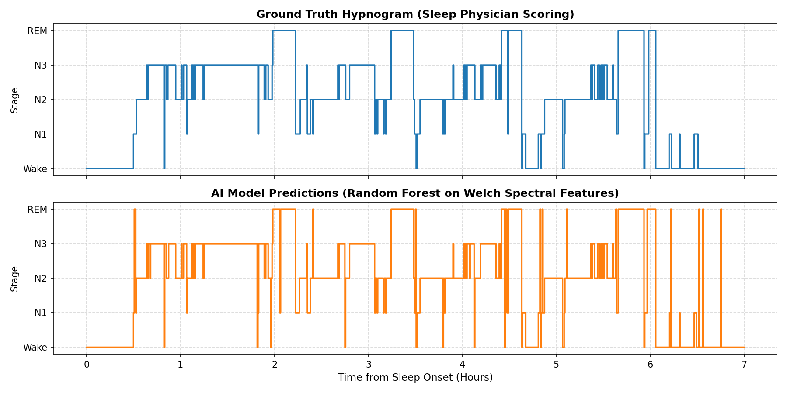
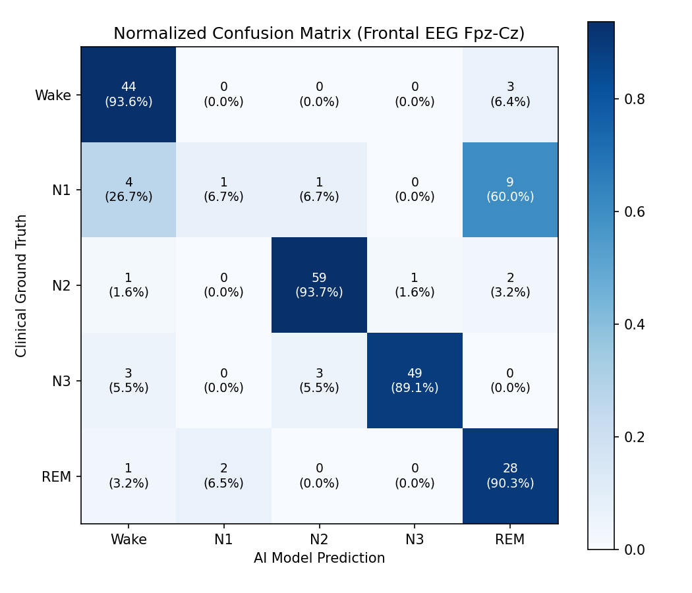

# Single-Channel Frontal EEG Sleep Stage Classifier (AASM 5-Stage)

**Author:** Rishi Maruvada  
**Target Architecture:** Wearable Frontal EEG (`EEG Fpz-Cz`)  
**Dataset:** PhysioNet Sleep-EDF Expanded (Cassette Study)  
**Model:** Random Forest on Welch Spectral Bandpower Densities  

---

## 1. Executive Summary & Biophysical Rationale
Commercial closed-loop neurotechnology (e.g., Affectable Sleep's *UltraSleep™* headband) relies on dry frontal electrodes to monitor sleep architecture and trigger phase-locked auditory stimulation during Slow-Wave Sleep (N3). 

While clinical Polysomnography (PSG) uses 10+ channels of EEG, EOG, and chin EMG, consumer form-factors are restricted to frontal montages. This project implements an end-to-end, single-channel sleep stage classifier on `EEG Fpz-Cz` that:
1. Rejects daytime wake-padding bias to restore natural class balance.
2. Extracts canonical biological frequency bandpowers via Welch's Power Spectral Density.
3. Evaluates 5-stage AASM sleep dynamics (Wake, N1, N2, N3, REM) on unseen test epochs.

---

## 2. Signal Processing & Preprocessing Pipeline
* **Montage:** Bipolar `EEG Fpz-Cz` (sampling rate: 100 Hz).
* **Bandpass Filtering:** Zero-phase FIR filter ($0.5\text{--}30.0\text{ Hz}$). The $0.5\text{ Hz}$ high-pass cutoff eliminates galvanic skin/perspiration drift without attenuating clinical Delta; the $30.0\text{ Hz}$ low-pass cutoff rejects facial EMG and 50 Hz power-line interference.
* **Wake-Padding Truncation:** Raw recordings often span 22+ hours, artificially skewing the dataset toward ~75% Wake. The pipeline algorithmically locates sleep onset and final morning awakening, cropping the signal to a 30-minute wake buffer on either side.
* **Epoching:** Segmented into standard non-overlapping 30-second AASM epochs ($N = 3,000$ samples per epoch).

---

## 3. Feature Extraction
For each 30-second epoch, Power Spectral Density (PSD) is computed using Welch's periodogram ($N_{\text{FFT}} = 400$, 4-second Hamming windows). Energy is integrated across five primary physiological bands:
* **Delta ($0.5\text{--}4.0\text{ Hz}$):** Cortical Up/Down states; dominant in Slow-Wave Sleep (N3).
* **Theta ($4.0\text{--}8.0\text{ Hz}$):** Drowsiness and REM transition marker.
* **Alpha ($8.0\text{--}12.0\text{ Hz}$):** Resting wakefulness.
* **Sigma / Spindles ($12.0\text{--}16.0\text{ Hz}$):** Thalamocortical gating signature; hallmark of Light Sleep (N2).
* **Beta ($16.0\text{--}30.0\text{ Hz}$):** Desynchronized cortical activation.

Features are log-transformed ($\log_{10}$) to stabilize exponential power distributions before being passed into a Random Forest Classifier (100 estimators).

---

## 4. Benchmark Validation & Results

### Overall Performance
* **Test Accuracy on Unseen Epochs:** **85.8%**
* **N3 (Deep Slow-Wave Sleep) F1-Score:** **0.93** (98% Precision, 89% Recall)
* **N2 (Light Sleep) F1-Score:** **0.94** (94% Precision, 94% Recall)
* **REM (Dreaming) F1-Score:** **0.77** (90% Recall)

### Visual Artifacts

#### A. Full-Night Hypnogram Comparison
The model accurately tracks the ~90-minute ultradian sleep cycle across all 7 hours, capturing all four distinct REM episodes and maintaining deep N3 stability.



#### B. Normalized Confusion Matrix


### Electrophysiological Error Analysis: The N1 / REM Trade-Off
In the confusion matrix, Stage N1 exhibits a recognized single-channel misclassification pattern, with 60% of N1 epochs predicted as REM. 

In clinical sleep medicine, N1 (drowsiness) and REM (dreaming) share near-identical low-amplitude, mixed-frequency (LAMF) theta background activity. Full clinical PSG differentiates them using submental EMG (muscle atonia during REM) and EOG (rapid eye movements). On a single frontal EEG channel where chin muscle tone is unavailable, this trade-off is an expected biophysical constraint.

---

## 5. Quickstart & Reproduction

```bash
# Clone the repository
git clone https://github.com/Rishi-Maruvada/sleep-stage-classifier.git
cd sleep-stage-classifier

# Install dependencies
pip install -r requirements.txt

# Run end-to-end pipeline
python3 main.py
```